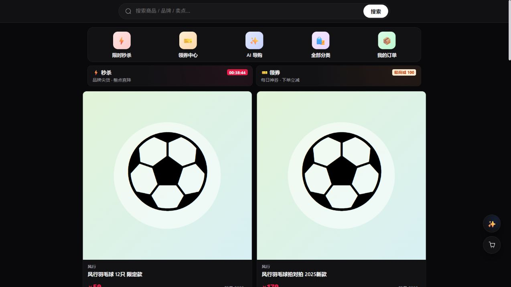

# 生产发布与端到端验收报告

日期：2026-10-28（Asia/Shanghai）。本次操作从 2026-10-27 跨日执行。

## 发布结论

- 工作区全部可提交更改已推送到 `origin/dev`；首批提交 `83d8520` 包含 89 个文件。密钥、私有交接材料、运行日志及忽略的构建产物没有入库。
- 最终部署业务代码：`f47e7908f323c79ac00724424ed3ee44685ddfb6`。本报告随后单独提交；报告提交不改变已验收的应用源码。
- 公开入口：`https://aimall.iflare.cn/aimall/`。
- 服务器应用已配套更新，最终 **9 个服务健康**。MySQL、Redis、MinIO、Milvus、对话模型与向量模型基础设施未被替换，数据卷未删除。
- 每次切换保留原提交、三个应用的旧镜像及权限 600 的数据库备份。没有执行破坏性数据库恢复，也没有宣称回滚流程经过故障演练。

## 本地发布门禁

| 检查 | 结果 |
|---|---:|
| AI 服务全量 pytest，包含实际 E2E 发现后的修复 | **388 passed** |
| Java 后端全量测试 | **683 passed，65 类，0 failures/errors** |
| 前端全量 Vitest | **332 passed，42 文件** |
| TypeScript `tsc --noEmit` | **通过** |
| `/aimall/` 基路径生产构建 | **通过** |
| eval 与商品目录工具测试 | **145 passed** |
| 部署约束与密钥卫生测试 | **19 passed** |

离线代理评测另已执行；其回复质量等分数不是线上模型质量，不能代替下面的真实流程。

## 真实生产检查

| 范围 | 通过数 | 覆盖 |
|---|---:|---|
| 版本、健康、HTTPS、资源和源文件一致性 | **30** | Git 提交/干净工作区、基础容器未变、更改应用已替换、数据库备份权限、全部更改 AI 源码哈希、公开 HTML/JS/CSS/favicon 与镜像字节一致、公开产品/分类 API、管理和内部路由保护 |
| 商务 API 与真实 MySQL 并发回归 | **41** | 买家注册不能提权、身份隔离、地址默认值并发、商品规格校验、购物车库存、订单归属、模拟支付/发货/收货、并发评价、全局排序、并发取消及库存回补、优惠券领取/释放、客服归属、禁用账号令牌失效 |
| 商家、动作确认、知识库及 AI 扩展流程 | **55** | 商家隔离和更新、真实四项商品事实、收藏/历史、AI 下单需确认与幂等、售后申请需确认与幂等、真实文档上传/向量入库/范围检索/引用一致性/重建/停用、真实 SSE 导购、政策引用、人工接入和双向消息 |
| 浏览器真实界面 | **18** | 首页、搜索、价格排序/区间筛选、商品事实/空态、320/390/1440 响应式宽度、访客加购保护、登录空值校验、买家/商家注册界面、公开优惠券/秒杀、匿名后台/商家/客服路由保护、详情错误重试及稳定返回导航 |
| 最终数据库、向量与健康独立复核 | **11** | 账号实际禁用、会话实际关闭、商品实际下架、券实际停用、测试文档逻辑删除及 Milvus 向量确实清除、平台规则 ACTIVE/40 向量、9 服务保持健康 |

上述是检查断言数量，不是“穷尽全部可能输入”的承诺。认证角色流程通过真实生产 API 验证；浏览器没有注入登录状态、读取 Cookie/本地存储或使用真实用户凭据，因此不宣称完成了各角色的浏览器登录后全页面人工遍历。

## 实测 SSE 与外部检索

| 场景 | 本次耗时 | 结果 |
|---|---:|---|
| 助手身份 | **0.14 秒** | 正常 token/done，确定性身份回复 |
| 真实模型导购 | **82.58 秒** | 实际调用商品检索；站内链接有效，当前价格不超过 3000 元且库存为正；未超时 |
| 平台规则 | **0.70 秒** | 实际知识库检索、4 条有效引用；生产采用明确标注的原文摘录模式，不把它描述成模型生成 |
| 明确转人工 | **0.10 秒** | 正常持久化等待状态，客服接入、买家/客服互发消息与结束服务全部通过 |
| 联网搜索工具 | **0.94 秒** | 实际 SearXNG 返回 3 条有效 HTTP(S) 来源；未新增付费搜索配置 |

导购仍明显偏慢，是本次 CPU 模型部署的主要性能限制。以上是单次样本，不是 P95/SLO 或高并发压测结果。联网搜索工具的真实来源请求通过，不等于已充分评估全部外部资讯的模型回答质量。

## E2E 发现并补发的修复

1. **无来源政策说法**：实际小模型未调用知识库，输出了“7 天或 14 天”等无依据说法。已增加明确政策问题识别、确定性检索、混合购物/政策双工具调度、流式输出独立校验，以及平台查询的 `POLICY/-1` 范围限制。先复现失败再补回归。
2. **CPU 证据生成超时**：强制检索后，小模型可能携带证据仍耗尽 180 秒。保留默认 `generate` 模式，生产配置 `KB_RESPONSE_MODE=extractive`：仅返回请求级来源映射认可的原文片段并明确标注，继续执行引用校验；不降低可回答阈值、不从常识补全政策。最终实测为 0.70 秒、4 引用。
3. **favicon 403**：私有 umask 的检出文件权限传播到镜像，favicon 为 600，Nginx 工作进程不可读。前端镜像构建增加对公开静态目录的读取/遍历权限；真实 HTTP 和镜像读取红灯已转为绿灯，公开图标字节哈希与镜像一致。
4. **平台规则历史未向量化**：原规则文档为 ACTIVE、40 chunks、0 vectors。保留原文重建为 version 2、40 vectors，状态 ACTIVE，未改政策文字或置信阈值。

补发的业务代码提交依次为 `656cfcf`、`8cc816b`、`f47e790`，均已推送并部署。测试脚本也按实际地址返回值、显式收货确认和优惠券表名修正后完整重跑；这些脚本契约错误没有被混同为产品缺陷。

## 隔离与清理

- 使用单独生成的 QA 买家、商家和客服账号，只输入虚拟姓名/电话/地址。
- 两个最终流程的测试商品已下架、测试优惠券停用、全部测试账号禁用、测试会话关闭；由 MySQL 再次独立核对。
- 两份测试知识文档逻辑删除，当前 Milvus 集合的对应向量数为零。
- 标记为 Synthetic/QA 的订单、评价、售后申请等审计记录保留；没有声称将业务记录和对象存储字节全部物理擦除，也没有删除正常用户数据。
- 各次失败尝试均执行隔离账号/商品清理；私有日志和回滚数据库未放入 Git。

## 浏览器记录与边界

- 最终首页刷新无新增控制台 error；未为使检查通过而新增根节点裁切，已记录实际 DOM 宽度和截图。
- 测试期间观察到一次详情加载失败提示，重试恢复；部署稳定后重新执行“详情→登录→返回详情”成功。保留这项恢复记录，不宣称零停机。
- 响应式检查使用真实浏览器视口仿真，不等同 iOS/Android 真机认证。
- 仅模拟支付与发货，没有对真实支付、短信或外部物流系统发起业务；没有做高并发、全营销文案一致性或灾难恢复演练。

机器可读结果：`2026-10-28-production-e2e.json`。包含脱敏断言、耗时和资源哈希，不包含密码、访问令牌或私有主机地址。
