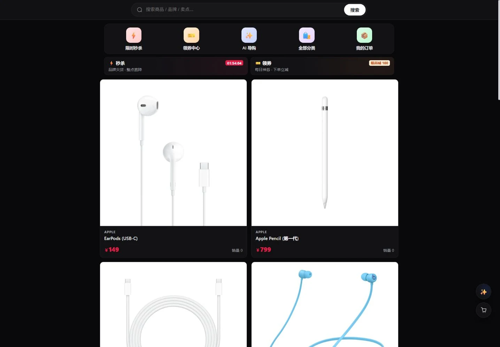
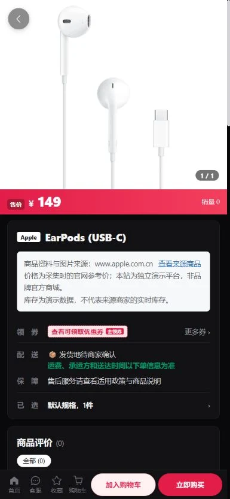
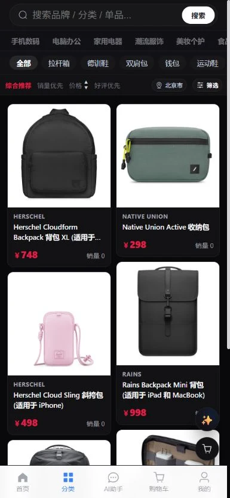

# 2026-10-28 商品真实图片修复与生产验收

## 结论与范围

本次针对“商品仍显示分类 emoji，而不是对应商品图片”的线上反馈。业务代码提交 `804a07c241e265d64e97e8d6ae5f8d2460b8f3cc`，生产仅更新前端容器和商品数据；不修改已应用的 Flyway 迁移，不替换基础设施或模型服务。

- 切换前：512 件在售演示商品全部使用分类 SVG；521 条未删除商品中共有 516 条 SVG 图片。
- 切换后：137 件有来源的商品、137 张独立内容寻址图片，在售商品中分类 SVG 为 0。
- 分类为手机数码 91、电脑办公 40、箱包 6。未验证的其他分类不再使用虚构商品填充。
- 商品名称、SKU、中文介绍、兼容性/技术规格/包装内容、人民币参考价和首张图库图片来自同一中国官网商品页。缺失的品牌、材质、产地等不猜测。
- 商品图片已下载、解码、规范化并保存至本站对象存储；原始图片和商品页地址仅用于溯源，不依赖浏览器外链加载。
- 库存是明确披露的演示数据，初始销量为 0；本站不是品牌官方商城，价格为采集时的官网参考价。

旧的 2512 行采集清单包含多种外币且结构化规格为空，本次未将其外币价格直接当作人民币导入；实际上线清单位于 `backend/src/main/resources/official-catalog/`。

## 根因与修复

1. `V12__category_images.sql` 对当时未删除商品按品类写入 SVG emoji。之前仅检查 HTTP 成功或 `naturalWidth > 0`，因此把成功加载的占位图误当作真实图片。
2. 新增严格的官网资料解析与采集：拒绝无 SKU、非人民币、不可购买、缺少图库图片或来源不符的条目。采集到 152 个候选页，137 件通过，15 件因不可购买或页面缺少所需模型而拒绝，没有以随机照片补数。
3. 新增受保护的目录切换：校验全部 512 条原始演示身份指纹及 V1 商家归属规则，事务内新增真实商品并下架演示商品，不复用旧 ID、不删除旧评论、不修改历史订单和购物车等关联。
4. 前端统一规范商品、SKU、购物车、订单图片的部署子路径；外链和原始来源地址不变。当前生产域名的根路径 API 同样可用，因此这项属于子路径兼容性保护，图片投诉的主因仍是占位数据。
5. 详情页增加来源链接、官网参考价、演示库存和非官方商城说明。保留已有资源读取权限修复。

## 测试证据

| 验证 | 结果 |
|---|---:|
| 商品采集/图片/导入 Python 回归 | 165 通过 |
| 前端完整测试（独立干净源码快照） | 335 通过 |
| TypeScript 类型检查 | 通过 |
| `/aimall/` 前端生产构建，本地与服务器 | 通过 |
| 部署与密钥卫生检查 | 19 通过（现有 Python 弃用警告 1 条） |
| 切换前公开验收复现 | 143 检查中 140 失败，成功复现占位图和真实目录缺失 |
| 切换后全部商品公开 API/图片验收 | 418 / 418 通过 |
| 桌面/手机真实浏览器检查 | 21 / 21 通过，浏览器错误日志为空 |
| 注册→购物车→下单→订单照片→取消→库存恢复→清空测试购物车 | 9 / 9 通过 |
| 切换及交易测试后原有记录指纹校验与隔离账号清理 | 11 / 11 通过 |
| 服务健康与容器范围 | 9 服务 healthy，仅前端容器更换 |

公开验收逐件核对 137 件商品的名称、SKU、来源页、原图地址、人民币价格、规格型号、分类/品牌关联、图片内容哈希，并实际下载每张线上图片验证 SHA-256、格式与解码；不是只检查 HTTP 200。视觉抽查首页、搜索、耳机详情、箱包列表/背包详情及电脑分类/分页。订单链路验证新订单快照保留同一商品的真实图片。

历史记录校验包括原有 18 个订单、18 个订单项、9 个收藏、13 条浏览记录、16 条评价、5 条知识库文档、原有商家/QA 商品和 512 条演示商品身份。交易测试新增的隔离订单已取消、库存恢复、购物车清空、测试账号禁用；不将测试新增行误算为原有数据被修改。

## 生产截图





## 复验命令

```powershell
python -m pytest backend/scripts/tests/product_catalog -q
npm --prefix frontend test
python -m backend.scripts.verify_product_photos --base-url https://aimall.iflare.cn/aimall --manifest backend/src/main/resources/official-catalog/products.jsonl --output .deployment-private/real-photos-check.json
```

重新采集（仅生成清单及本地图，不自动修改数据库）：

```powershell
python -m backend.scripts.collect_official_catalog --output backend/src/main/resources/official-catalog --images backend/.catalog-cache/official-cn
```

## 运维安全与回滚

- 数据库完整备份、旧前端镜像 ID、切换前后记录摘要、图片归档及运行环境均保存在服务器私有发布目录，不提交密钥、备份、账户凭据或原始私有日志。
- 上线前 `validate_catalog_images` 校验全部本地图片，再上传并重新读取对象存储核对哈希，然后对 `replace_demo_catalog(..., dry_run=True)` 演练，最后显式 `dry_run=False` 执行事务。
- 切换器只接受准确匹配的 V1/V12 演示目录，并检查来源身份冲突；已经切换后重复执行会拒绝，而不是覆盖商品或重复导入。
- 常规回滚应保留新旧商品 ID 和所有订单：将本次来源清单对应的新商品下架，审核原演示商品身份未变化后恢复其原状态；不要删除新商品或使用整库恢复覆盖上线后新产生的正常订单。旧镜像 ID 已保留，可恢复前端镜像并仅重建前端。
- 历史订单继续保留原商品与原图片快照。不能把旧演示订单改配成新商品照片；本次新订单图片链路已单独验收。
- 工作区另有并行中的聊天、缓存、订单页等更改，本次使用干净源码快照与独立暂存索引，仅提交和发布本次图片修复，没有覆盖或夹带那些未完成更改。

## AI 商品索引

- AI 服务实时状态：`collection_exists=true`、`corpus_ready=true`、`product_count=137`。
- Milvus 强一致读取：137 条当前商品向量，原 512 条演示商品向量为 0；向量商品 ID 全部对应本次新目录。
- CPU 批量向量化较慢：手动同步请求等待 420 秒后超时，但服务端任务继续运行。生产日志确认北京时间 2026-10-28 12:07:37 完成 `indexed=137`，随后直接读取向量集合验收通过；不能把触发请求超时当作最终同步失败，也不宣称该批处理已达到低延迟。
- BM25 当前语料在向量化完成前已更新至 137 件商品；图片显示不依赖批量向量化完成。本次未修改或重启 AI/模型服务。
